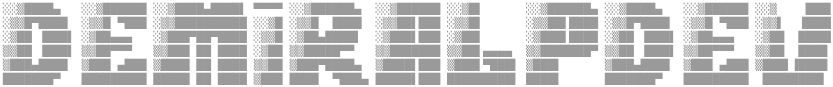

<div align="center">



### Creative Developer & Cyber-Architect • AI Builder

[](https://demiralpdev.tech)
[](https://github.com/demiralpdev)
[](https://demiralpdev.tech)
[](mailto:info@demiralpdev.tech)

</div>

```bash
$ whoami
Name    : DEMİRALP (Demir Alp Gündoğmuş)
Role    : Creative Developer & AI Builder
Skills  : Android Studio • C# • .NET • MySQL • Python • JavaScript • HTML • CSS
```

### ⚡ Featured Projects

- 🧠 **[Caphlon](https://caphlon.dev)** — 4.5 GiB GGUF build of Qwen 3.8 27B running locally on 8 GB RAM.
- 🔐 **[.RISE](https://riseproof.me)** — Cryptographic proof of origin (.rise / .rvid) sealed at capture time.
- 📊 **[GPU Pusula / 2elAnaliz](https://2elanaliz-panel.vercel.app)** — Real-time secondary GPU market analysis and value index.

<div align="center">


---

**[🌐 demiralpdev.tech](https://demiralpdev.tech)** • **[✉️ info@demiralpdev.tech](mailto:info@demiralpdev.tech)**

</div>
